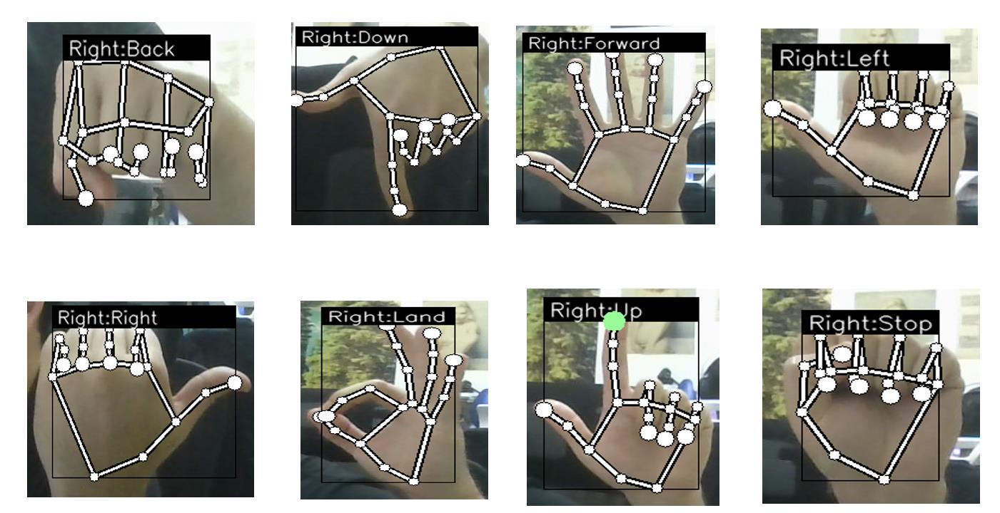

# Vision-Based Hand Gesture Controlled Drone System

A Python interface that turns webcam hand gestures into MAVLink velocity and landing commands. MediaPipe estimates hand landmarks, TensorFlow Lite classifies the gesture, and a short voting buffer decides when to send a command through DroneKit.

[Watch the hand-gesture drone demonstration on Bilibili](https://www.bilibili.com/video/BV1Lm421n7jQ/)

This project accompanies Garayev Atajan's June 2024 undergraduate thesis, *Vision Based Gesture Controlled Drone System*, at Chongqing University of Posts and Telecommunications. It explores a camera-based interface for eight drone commands using hand landmarks, a compact neural classifier and MAVLink control.



*Gesture examples from the author's thesis, Figure 5.4, printed page 58.*

## Thesis platform and reported results

The thesis describes a Prometheus 450 (P450) platform with a Pixhawk V6C flight controller, NVIDIA Jetson NX companion computer and a USB camera. Its hardware inventory also includes Intel T265 and D435i cameras and an RPLIDAR S1. The Python application uses a camera feed and a MAVLink connection; it does not implement SLAM, depth processing or LiDAR obstacle avoidance.

| Measurement | Thesis-reported result | Source |
|---|---|---|
| Recognizing and executing the eight predefined gestures | 98% success rate | Chapter 5, printed page 59 |
| Gesture recognition to corresponding command execution | Approximately 0.3 s average response time | Chapter 5, printed pages 58-59 |

Chapter 5 describes testing with different lighting, backgrounds and users, but does not supply trial counts, raw flight logs or timing traces for these aggregate results. They are historical thesis reports, not measurements reproduced from the current checkout. The reported response time is not a camera-to-vehicle latency guarantee.

See [thesis notes and reproduction details](docs/THESIS.md) for the hardware inventory, classifier evaluation, source pages and differences between the thesis and the current code, including the firmware configuration.

## How it works

```text
Webcam → MediaPipe hand landmarks → normalized 2D coordinates
       → TensorFlow Lite gesture classifier → gesture buffer
       → DroneKit / MAVLink → flight controller
```

The recognizer tracks one hand and converts 21 landmarks into 42 normalized coordinates. Eight static gesture classes provide movement, stop and land commands. With the default five-frame buffer, at least four matching observations are needed before a command is emitted.

A second TensorFlow Lite model classifies a 16-frame point history. The current flight controller receives the static hand-sign ID. The point-history classifier does not drive the flight commands.

## Gesture commands

The labels come from `model/keypoint_classifier/keypoint_classifier_label.csv`. Velocities use `MAV_FRAME_LOCAL_NED`, with positive axes pointing north, east and down. The horizontal labels refer to those local axes, regardless of the drone's heading.

| ID | Classifier label | Command sent |
|---|---|---|
| 0 | Forward | North at 1 m/s |
| 1 | Stop | Zero velocity |
| 2 | Up | Up at 1 m/s (`vz = -1`) |
| 3 | Land | Switch to `LAND` mode |
| 4 | Down | Down at 1 m/s (`vz = +1`) |
| 5 | Back | South at 1 m/s |
| 6 | Left | West at 1 m/s |
| 7 | Right | East at 1 m/s |

These are the actual values in `gestures/gesture_controller.py`. The controller sends velocity and landing commands only while the vehicle reports `GUIDED` mode. Its takeoff helper is separate from the gesture mapping.

## Setup

You need a webcam and a MAVLink endpoint compatible with DroneKit and the controller's `GUIDED`/`LAND` modes. Start with an ArduPilot SITL simulator and validate the gesture mapping there before connecting flight hardware.

The original training notebook records Python 3.8.5. The dependency file provides compatibility constraints for the legacy MediaPipe Solutions and TensorFlow Lite APIs. This cleanup was checked without installing the full runtime or operating a vehicle, so the dependency set and hardware behavior still need environment-specific validation. Python 3.9 is a candidate for the older DroneKit API, whose compatibility with newer Python releases is limited.

From the repository root, create and activate a virtual environment, then run:

```bash
python -m pip install -r requirements.txt
```

Keep the `model/` directory in place. Both the model files and label paths are relative to the working directory.

### Check hand recognition first

```bash
python -m tests.gesture_test --device 0
```

This opens the webcam recognition display without creating a DroneKit vehicle connection. Press **Esc** to close it. The scripts under `tests/` are interactive camera or connection checks. A hardware-free regression suite is not included.

### Connect to a simulator or vehicle

Use the connection string configured by your MAVLink setup. For example, if a local SITL instance exposes TCP port 5760:

```bash
python main.py --connection_string tcp:127.0.0.1:5760
```

Camera and recognition settings are read from `config.txt` and can be overridden:

```bash
python main.py --device 0 --width 960 --height 540 --buffer_len 5 --connection_string tcp:127.0.0.1:5760
```

The application connects to the endpoint when it starts. Establish the simulator or vehicle state and flight mode independently before issuing gesture commands. Closing the display closes the connection. It does not request landing.

## Models and training

The repository includes TensorFlow Lite inference models, HDF5 checkpoints, label files and landmark CSV data.

The notebook's base classifier maps 42 inputs through dense layers of 32, 32 and 16 ReLU units to eight softmax outputs. It also explores hyperparameters; the base architecture should not be assumed to identify every bundled checkpoint. The thesis's classifier report is separate from its gesture-command success rate; see [evaluation context](docs/THESIS.md#reported-evaluation).

The `Keypoint_model_training.ipynb` notebook uses eight classes and a 75/25 train/test split. To run it from the repository root, set its paths to:

```python
dataset = 'model/keypoint_classifier/keypoint.csv'
model_save_path = 'model/keypoint_classifier/keypoint_classifier.hdf5'
tflite_save_path = 'model/keypoint_classifier/keypoint_classifier.tflite'
```

Notebook plotting and training also use pandas, scikit-learn, matplotlib, seaborn and Jupyter. Install them separately if retraining is needed. Replacing a classifier requires keeping its output IDs aligned with the label CSV and the flight-command table.

## Limits

- Lighting, occlusion and hand orientation can change recognition results. Per-frame model inference, gesture buffering and vehicle response contribute different delays; the thesis's aggregate response-time report does not separate them.
- The static classifier selects the highest-scoring class without a confidence rejection threshold.
- Losing the hand produces ID `-1`, which has no mapped flight action. It does not explicitly send a stop command.
- The app has no independent collision avoidance, geofence or flight watchdog. Link-loss behavior depends on the flight controller's configured failsafes.
- The main loop can block on connection or vehicle operations. Camera failure currently retries capture.
- The video and thesis document the system, but the repository has no raw evaluation records or automated protocol that reproduces the thesis's aggregate success rate and response time across users or flight conditions.

## Repository guide

| Path | Purpose |
|---|---|
| `main.py`, `config.txt` | Webcam-to-command loop and configuration |
| `gestures/gesture_recognition.py` | Landmark extraction, preprocessing, classifiers and voting buffer |
| `gestures/gesture_controller.py` | MAVLink commands and vehicle connection |
| `model/` | Inference models, checkpoints, labels and landmark datasets |
| `Keypoint_model_training.ipynb` | Keypoint-classifier training and export |
| `tests/` | Interactive recognition and connection checks |
| `utils/cvfpscalc.py` | Displayed loop-rate calculation |
| `docs/THESIS.md` | Thesis context, reported results and reproduction gaps |

## License and acknowledgments

The repository retains its existing [GNU GPL v3 license](LICENSE).

The landmark preprocessing, classifier wrappers and FPS utility share code with the Apache-2.0 [MediaPipe hand-gesture recognition sample by kinivi](https://github.com/kinivi/hand-gesture-recognition-mediapipe). The FPS utility matches that sample. See [third-party notices](THIRD_PARTY_NOTICES.md) and the included [Apache license](LICENSES/Apache-2.0.txt) for this upstream material.

The system uses [MediaPipe](https://github.com/google-ai-edge/mediapipe), [TensorFlow](https://github.com/tensorflow/tensorflow), [OpenCV](https://opencv.org/), [DroneKit](https://github.com/dronekit/dronekit-python) and [MAVLink](https://mavlink.io/). Each dependency retains its own license.

