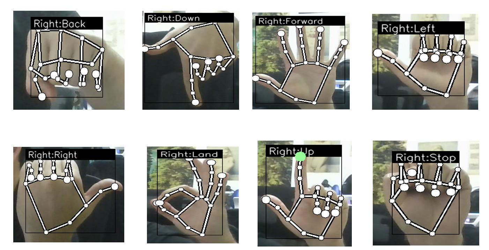

# Thesis context and reproduction notes

## Source

Garayev Atajan. *Vision Based Gesture Controlled Drone System*. Undergraduate graduation thesis, Computer Science and Technology, Chongqing University of Posts and Telecommunications, June 2024. Supervisor: Zhang Yan.

These notes summarize the author's thesis and compare it with the repository. Page references use the printed page numbers in the thesis body; the corresponding PDF page is ten pages later. For example, printed page 58 is PDF page 68. The full thesis is not included in this repository.

## System and hardware

Chapter 3 presents a pipeline from camera images to hand landmarks, gesture classification and vehicle commands (Section 3.1, printed page 17). Section 4.1 describes the following hardware (printed pages 28-30):

| Component | Role described in the thesis | Relationship to this application |
|---|---|---|
| Prometheus 450 / P450 | Multirotor research platform | Physical platform used in the thesis; not needed for the camera-only check |
| Pixhawk V6C / 6C | Flight control and motor commands | Target for MAVLink control; the Python code expects `GUIDED` and `LAND` modes |
| NVIDIA Jetson NX | Companion computing | Described deployment computer; no Jetson image or validated environment is supplied here |
| 2 MP USB monocular camera | Video input | The application opens a camera through OpenCV |
| Intel T265 and Intel D435i | Tracking and depth-sensing hardware in the platform inventory | No tracking, SLAM or depth-processing integration in the gesture-control application |
| RPLIDAR S1 | Ranging sensor in the platform inventory | No LiDAR processing or obstacle-avoidance integration in the application |
| GPS, Wi-Fi data link and RC transmitter/receiver | Positioning, communication and manual control | Configured outside the application |

The thesis describes UART communication between the Jetson NX and Pixhawk (printed page 30). The application accepts a DroneKit connection string, so the endpoint must match the actual serial connection or MAVLink bridge. The repository's TCP default is a configuration example, not a universal hardware address.

The hardware drawings in thesis Figures 4.1 and 4.2 credit Amov Lab (2021). They are not redistributed here.

## Recognition and command pipeline

The implementation uses MediaPipe to locate one hand, then converts 21 landmarks into a 42-value vector of 2D coordinates. Coordinates are made relative to the wrist and normalized by the largest absolute coordinate before TensorFlow Lite classification. This separates hand localization from learning the eight command classes.

The base network shown in the thesis and training notebook has the following shape (printed pages 39-40):

```text
42 coordinates -> Dense(32, ReLU) -> Dense(32, ReLU)
               -> Dense(16, ReLU) -> Dense(8, softmax)
```

The notebook also includes dropout layers and hyperparameter experiments. Its base model sets dropout to zero, so the presence of dropout layers does not itself establish regularization. The repository does not record a complete training run manifest tying every bundled checkpoint to one architecture and dataset version.

The eight classes are Forward, Stop, Up, Land, Down, Back, Left and Right. Their IDs and MAVLink commands are documented in the [README command table](../README.md#gesture-commands). The controller uses local north-east-down axes, rather than heading-relative motion. The takeoff helper exists separately and is not called by the main gesture loop.



*Figure 5.4, printed page 58 (PDF page 68), extracted from the author's thesis. The image illustrates gesture appearances and recognition labels; it is not an additional experiment or flight-safety validation.*

The voting buffer reduces reactions to isolated classification changes. In the current code, the default buffer length is five and the threshold is four matching observations; the buffer clears after emission. This consistency requirement adds a frame-dependent delay. A separate point-history classifier is present, but the flight commands use the static gesture ID.

Implementation references: [recognition and voting](../gestures/gesture_recognition.py), [vehicle commands](../gestures/gesture_controller.py), [main loop](../main.py) and [training notebook](../Keypoint_model_training.ipynb).

## Reported evaluation

### Landmark-classifier evaluation

Section 4.2, Figure 4.3 (printed page 41), shows a confusion matrix and a classification report. The displayed report has a total support of 1,548 samples and per-class precision values rounded to 0.97-1.00. Its accuracy is printed as `1.00` at two decimal places; the confusion matrix contains misclassifications, so that rounded display should not be presented as error-free classification.

This is a classifier evaluation on landmark vectors, distinct from the vehicle-level success rate below. The adjacent prose calls the test set 30% of the data, while the current notebook specifies a 75/25 split. The figure is not established as a fresh evaluation of the currently bundled TensorFlow Lite file.

Printed page 45 describes an imbalanced collection: three gestures with more than 300 examples each and five with approximately 40-150 each. That summary and Figure 4.3 do not provide a versioned dataset manifest identifying the exact inputs for each experiment.

### Gesture-command testing

Chapter 5 (printed pages 56-59) describes camera and vehicle setup, QGroundControl checks and gesture trials. It reports indoor and outdoor settings, varying lighting and backgrounds, and multiple users.

| Reported measurement | Value | Thesis location |
|---|---|---|
| Success in recognizing and executing the predefined gestures | 98% | Printed page 59 |
| Average response from gesture recognition to command execution | Approximately 0.3 seconds | Definition on printed page 58; value on page 59 |

These values are transcribed from the thesis, not independently rerun or verified during documentation preparation. Chapter 5 does not specify the number of command trials or users, per-condition counts, timing instrumentation, uncertainty or a breakdown of recognition and execution failures. Raw flight logs and timing traces are not included in the repository. The response-time value should not be interpreted as a measured camera-exposure-to-physical-motion latency or a guaranteed upper bound.

## Differences that affect reproduction

| Topic | Thesis account | Current repository and interpretation |
|---|---|---|
| Flight firmware | Section 4.3 names PX4 on printed page 50; the orders-management discussion names ArduCopter on pages 54-55 | The controller checks `GUIDED` mode and uses DroneKit. The thesis does not resolve the final firmware/version. PX4 compatibility is not established; begin by checking commands in an ArduPilot SITL environment, then record the actual hardware firmware and parameters. |
| Dataset split | The prose beside Figure 4.3 says 30% test data (page 41) | The notebook uses `train_size=0.75`, hence 25% test data. Reproduction must identify the intended dataset and split. |
| Evaluation independence | The thesis describes a test/validation result (pages 40-41) | The notebook uses `X_test` for validation during training and hyperparameter exploration. That split is not an untouched final test set; an independent evaluation is needed to establish generalization. |
| Gesture buffering | Orders management describes more than half the buffer agreeing (page 54) | The code threshold is `buffer_len - 1`, or four observations at the default length of five. |
| Hand-loss behavior | Chapter 5 describes the drone remaining stationary when gestures are absent (page 58) | No hand returns ID `-1`, which has no mapped stop action. The application does not explicitly request hover or zero velocity on hand loss. Flight-controller behavior depends on its configuration. |
| Vertical command comments | The controller listing labels ID 4 as Up and ID 2 as Down (page 46) | The numerical velocities use NED: ID 2 has `vz=-1` (up), ID 4 has `vz=+1` (down), matching the current label CSV. The README follows the numeric mapping. |
| Platform sensors | The hardware inventory includes depth cameras and LiDAR (pages 29-30) | Their presence does not establish SLAM or collision avoidance in the provided application. |

## Reproducing the results

Start with the [camera-only check and simulator instructions](../README.md#setup). A new quantitative evaluation would need:

1. A recorded environment: Python and dependency versions, computer, camera settings, model hash, dataset hash, firmware version and flight-controller parameters.
2. Separate training, validation and held-out evaluation data, ideally separated by participant or recording session to measure performance on unseen users and conditions.
3. Per-class precision, recall and confusion counts on that held-out set, with the number of samples and participants reported.
4. Command trials with ground-truth gesture labels, recognized IDs, emitted MAVLink commands, timestamps and vehicle telemetry. Count recognition failures and execution failures separately.
5. Explicit timing boundaries for capture, inference, buffering, transmission and vehicle response, with trial counts and timing distributions.

Those records would allow the historical thesis results to be compared with a measured result from a specific repository revision.
